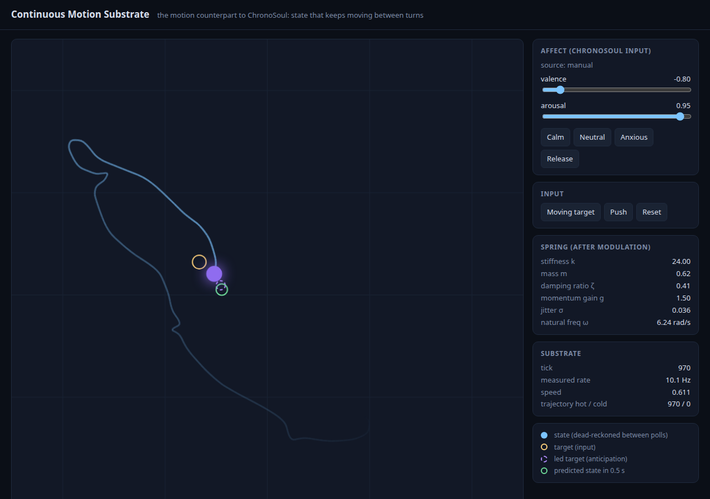

# Continuous Motion Substrate


> The motion counterpart to [ChronoSoul](https://github.com/AaronGrace978/continuous-emotional-substrate): a persistent, always-integrating state vector for agents that never freeze between frames.

LLM agents freeze between turns. They exist only while a message is being processed, and they cold-start on the next one.

[ChronoSoul (continuous-emotional-substrate)](https://github.com/AaronGrace978/continuous-emotional-substrate) fixed the **emotional freeze**: mood and memory keep evolving in a background loop whether anyone is talking or not.

This repo fixes the **motion freeze**. The agent keeps a continuous state vector with position, velocity, and momentum. It integrates on a fixed 10 Hz tick between frames and turns, it remembers the path it took, it predicts where it is going, and it survives restarts. It is not a parallel system. **ChronoSoul's valence and arousal are an input**, so mood is felt as motion: an anxious state moves tight, fast, and jittery, and a calm state moves slow, heavy, and damped.

---

## Demo



`python server.py`, then open <http://127.0.0.1:47400>. The screenshot was taken from this repo's visualizer, in anxious mood (valence −0.80, arousal 0.95) with a moving target:

- **Blue dot:** the state. It is polled at 10 Hz and dead-reckoned from its velocity between polls.
- **Trail:** the last 4 s of stored trajectory, replayed at 60 Hz with Hermite interpolation.
- **Yellow ring:** the input target. **Dashed ring:** the target as led by the anticipation layer. **Green ring:** the substrate's own forecast of where it will be in 0.5 s.
- **Side panel:** valence/arousal sliders with Calm, Neutral, and Anxious presets, plus the spring parameters they produce, live.

Click to set a target. Then stop clicking: the dot keeps moving, settles, and the target relaxes back to rest. Kill the server and start it again: the state resumes where it was, and the time it was down is integrated.

---

## Architecture

```
 ┌───────────────────────────────┐
 │ ChronoSoul (optional)         │   in-process ContinuousSubstrate,
 │   valence, arousal            │   or its chamber's GET /state,
 └───────────────┬───────────────┘   or the offline simulator
                 │ chronosoul_bridge.py   AffectSource.read_affect()
                 ▼
 ┌────────────────────────────────────────────────────────────────────┐
 │                 CONTINUOUS MOTION SUBSTRATE  (10 Hz tick)          │
 │                                                                    │
 │  inbox ─► modulate(base, affect) ─► target decay ─► anticipation   │
 │  (targets,     k, m, ζ, g, σ          toward rest     lead target  │
 │   impulses)                                           (momentum.py)│
 │                          │                                 │       │
 │                          ▼                                 ▼       │
 │             damped spring integrator (dynamics.py) ◄───────┘       │
 │             semi-implicit Euler, 4 substeps, seeded jitter         │
 └──────────────────────────┬─────────────────────────────────────────┘
                            ▼
 ┌────────────────────────────────────────────────────────────────────┐
 │ SQLite  motion_substrate.db  (trajectory.py)                       │
 │   samples: hot tier (newest 6000 ticks) + cold tier (never deleted)│
 │   meta:    latest state vector + anticipator state                 │
 └──────────────────────────┬─────────────────────────────────────────┘
                            ▼
      server.py  ─  /tick  /state  /trajectory  /reset  /affect  + canvas at /
```

### Files

| File | Role |
| --- | --- |
| `motion_substrate.py` | `ContinuousMotionSubstrate`: one class, an explicit `tick_once()`, a fixed-rate background loop, save/load, dormancy catch-up. |
| `dynamics.py` | The damped spring as pure functions: `integrate`, `acceleration`, `decay_toward`. |
| `trajectory.py` | `TrajectoryStore` (two-tier SQLite), cubic Hermite `interpolate`, `replay` at any rate. |
| `momentum.py` | Input-velocity estimation, target leading, and noise-free forecast rollouts. |
| `chronosoul_bridge.py` | `AffectSource` protocol, the emotion→motion `modulate()` formula, ChronoSoul adapters, and the offline simulator. |
| `providers.py` | Affect-source settings in `motion_providers.json` (gitignored, 0600). |
| `server.py`, `static/index.html` | FastAPI server and live canvas visualizer. |
| `motion_eval.py` | Produces every number in this README. |
| `tests/` | pytest suite (64 tests). |

### The tick

Every tick (dt = 0.1 s by default, fixed, independent of wall-clock jitter):

1. Drain the inbox (new targets, velocity impulses, a new rest point).
2. Read valence/arousal from the affect source and compute the spring parameters.
3. Decay the target toward rest (half-life 8 s). With no input, motion settles; it doesn't hold a stale target forever. This is the motion version of ChronoSoul's homeostatic drift.
4. Update the input-velocity estimate and lead the target (see *Anticipation*).
5. Integrate `m·x'' = k·(target − x) − c·x' + k·σ·noise` with semi-implicit Euler, 4 substeps per tick. The noise is drawn from an RNG seeded by `(seed, tick)`, so runs are reproducible, including across restarts.
6. Append the sample to the trajectory store. Every 50 ticks, flush the state vector.

The background loop schedules ticks on a monotonic clock. If it falls behind, it runs up to 5 ticks to catch up, then drops the rest and counts them in `dropped_ticks`.

### Emotional coupling (the formula)

From ChronoSoul's affect, with valence `v ∈ [−1, 1]` and arousal in `[0, 1]`, arousal is first mapped exactly as ChronoSoul's `steering.py` does, so that rest (0.4) is 0:

```
a' = clamp((arousal − 0.4) / 0.4, −1, 1)
v  = clamp(valence, −1, 1)

stiffness       k = k0 · 2^(a')                                     arousal tightens the spring
mass            m = m0 · 2^(−0.7·a')                                calm is heavier
damping ratio   ζ = clamp(ζ0 · 2^(−0.8·a') · (1 + 0.25·v), 0.15, 2.5)
damping         c = 2 · ζ · √(k·m)
momentum gain   g = g0 · (1 + 0.5·a')                               how far anticipation leads
jitter          σ = σ0 · max(0, a') · (1 − v) / 2                   only aroused AND unpleasant shakes
```

Base values: `k0 = 12`, `m0 = 1`, `ζ0 = 0.9`, `g0 = 1`, `σ0 = 0.04` (`BaseDynamics`). The jitter term means excitement (high arousal, positive valence) is fast but steady; only anxiety (high arousal, negative valence) trembles.

### Anticipation

A spring tracking an input moving at speed `u` trails it by about `c·u/k`. `momentum.py` estimates the input's velocity (exponentially smoothed, τ = 0.3 s) and drives the spring toward `target + g · (c/k) · input_velocity` instead of the raw target. With `g = 1`, that cancels the lag. Mood sets `g`, so an anxious agent leads too much and runs ahead of its input, and a calm one under-leads and trails. `predict_state()` separately rolls the noise-free spring forward to report where the state will be in 0.5 s.

### Persistence

One SQLite file holds everything, laid out like ChronoSoul's `memory_store.py`:

- `samples`: one row per tick (position, velocity, target, valence, arousal) with a `tier` column. The newest `hot_limit` (6000 = 10 min) rows are `hot`; older rows are moved to `cold` and **never deleted**. Window reads and replays span both tiers.
- `meta`: the latest state vector and the anticipator's state, as JSON.

On startup the substrate reloads that state. Like ChronoSoul's dormancy, it then integrates the time it was closed (capped at 10 minutes, by which point the spring has long settled), recording only the final sample, and reports `dormant_for`.

---

## Quickstart

Python 3.10+. No API keys, no network, no GPU.

```bash
pip install -r requirements.txt

python server.py           # visualizer at http://127.0.0.1:47400  (MOTION_PORT to change)
python -m pytest -q        # test suite
python motion_eval.py      # the measurements below
```

Headless:

```python
from motion_substrate import ContinuousMotionSubstrate
from chronosoul_bridge import StaticAffectSource

sub = ContinuousMotionSubstrate("motion_substrate.db", affect_source=StaticAffectSource(valence=-0.8, arousal=0.95))
sub.set_target([1.0, 0.0])
sub.start_background()          # keeps integrating at 10 Hz until stop_background()
...
print(sub.snapshot())           # position, velocity, momentum, params, 0.5 s prediction
sub.close()
```

### HTTP API

| Method | Path | Body / query | Does |
| --- | --- | --- | --- |
| GET | `/` | | Live visualizer |
| GET | `/state` | | State, momentum, affect, spring params, 0.5 s prediction, tier counts |
| POST | `/tick` | `{"steps": 1, "target": [x, y]}` | Advance N ticks synchronously, optionally setting a target first |
| POST | `/target` | `{"target": [x, y]}` or `{"impulse": [dx, dy]}` | Queue input for the running loop |
| GET | `/trajectory` | `?seconds=5&rate_hz=30&include_samples=true` | Raw samples plus a Hermite-interpolated replay |
| POST | `/reset` | `{"clear_trajectory": false}` | Back to rest; history kept unless asked |
| POST | `/affect` | `{"valence": v, "arousal": a}` or `{"release": true}` | Manual mood override, or back to the configured source |
| GET | `/providers` | | Affect-source settings (a token is reported only as `has_token`) |

### Connecting ChronoSoul

`motion_providers.json` (gitignored, written at 0600, the same pattern as ChronoSoul's `chronosoul_providers.json`) selects the affect source. `MOTION_AFFECT_SOURCE` overrides it.

```json
{
  "affect_source": "chronosoul_http",
  "chronosoul_url": "http://127.0.0.1:47321/state",
  "chronosoul_repo": "",
  "chronosoul_token": ""
}
```

| `affect_source` | Reads from |
| --- | --- |
| `simulated` (default) | Offline drift with ChronoSoul's homeostatic constants (valence → 0.1, arousal → 0.25) plus a slow wander. |
| `manual` | A fixed mood, set from the visualizer or `POST /affect`. |
| `chronosoul_http` | A running ChronoSoul desktop chamber (`chat_server.py`, port 47321, `GET /state` → `{"affect": {...}}`). Polled on a background thread at 1 Hz so the tick never blocks; falls back to simulated when unreachable. |
| `chronosoul` | An in-process `ContinuousSubstrate` imported from the checkout at `chronosoul_repo`. Falls back to simulated if the import fails. |

There is no secret in the code. The chamber needs no token. If you put it behind an authenticating proxy, the token comes from `CHRONOSOUL_TOKEN` or the settings file and is sent as a Bearer header.

In code, any object with `.affect.valence` and `.affect.arousal` works:

```python
from chronosoul_bridge import ChronoSoulAffectSource
sub = ContinuousMotionSubstrate(affect_source=ChronoSoulAffectSource(chronosoul_substrate))
```

---

## Measurements

All from `python motion_eval.py`: deterministic, simulated, 1-D, 10 Hz, noise off except where noted. These are measurements of this model's behaviour, not benchmarks against anything else.

| mood (valence, arousal) | k | m | ζ | overshoot | rise 10–90% | settle 2% | jitter RMS | ramp lag, reactive | ramp lag, anticipating | 0.5 s forecast RMS |
| --- | ---: | ---: | ---: | ---: | ---: | ---: | ---: | ---: | ---: | ---: |
| calm (+0.6, 0.0) | 6.00 | 1.62 | 1.80 | 0.0% | 4.0 s | 6.9 s | 0 | +0.890 | +0.433 | 0.039 |
| neutral (0.0, 0.4) | 12.00 | 1.00 | 0.90 | 0.0% | 0.9 s | 1.4 s | 0 | +0.229 | −0.031 | 0.103 |
| anxious (−0.8, 0.95) | 24.00 | 0.62 | 0.41 | 22.4% | 0.3 s | 1.2 s | 0.069 | +0.035 | −0.064 | 0.232 |

How to read it:

- **Step metrics** are for a unit step from rest, sampled at the tick rate. Neutral's 0.0% is rounded: ζ = 0.9 has a continuous-time overshoot of about 0.15%, and the 10 Hz samples catch 0.02% of it.
- **Jitter RMS** is the distance from a held target over 30 s once settled, with noise on.
- **Ramp lag** is the mean `target − position` over the second half of a 10 s ramp at 0.5 units/s. Positive means trailing, negative means ahead. Anticipation cuts neutral lag from 0.229 to 0.031. It makes anxious *lead* the input, and calm still trails because its gain is 0.5 and its overdamped spring is still catching up after 5 s.
- **0.5 s forecast RMS** is with noise on and the input still moving (`sin(0.8 t)`). The forecast assumes the input holds still, so a faster spring and a moving input both make it worse. Anxious is the least predictable, by design.

Also measured, and asserted by the tests:

- A one-tick noise-free forecast matches the next tick exactly (worst error 0.0 across moods).
- Restarting mid-motion reproduces, value for value, the path of a run that never stopped, including seeded jitter.
- Hermite replay of 10 Hz samples at 40 Hz differs from the true sub-tick states by at most about 0.001 (neutral) and 0.003 (anxious) on a unit step.
- With the server running, the visualizer measured 10.1 Hz. The bare tick loop ran at about 50,000 recorded ticks/s single-threaded with in-memory SQLite on the development VM, so 10 Hz leaves a lot of headroom. That number is machine-dependent.

---

## Relationship to ChronoSoul

**Shared (by design):**

- The thesis: an agent should have a substrate that runs between turns instead of cold-starting.
- One substrate class with an explicit tick (`tick_once`) and a `start_background` / `stop_background` daemon loop.
- Exponential decay toward a homeostatic baseline (ChronoSoul's mood drift and memory resonance; here, the target relaxing to rest).
- Two-tier SQLite: a bounded hot tier plus a cold tier that overflow is archived to and never deleted from, with WAL mode and the same `meta` key-value table.
- Dormancy: on restart, integrate the time the process was closed and report it.
- A gitignored, 0600 JSON settings file, no hard-coded secrets, tokens from environment variables, and secrets never returned by GET endpoints.
- A fully offline simulated mode.
- Arousal → coefficient mapping `(arousal − 0.4) / 0.4`, the same as `steering.py`, so a given mood means the same thing to both substrates.
- An honesty standard: an eval script produces the numbers, and the README reports only those.

**New here:**

- The state is kinematic (position, velocity, momentum), not affective, and it is integrated as physics with a fixed dt.
- Trajectory memory stores the whole path, with interpolation and replay, rather than discrete memory enclaves.
- Anticipation: acting ahead of the input via input-velocity estimation and target leading, plus forecast rollouts.
- Emotion is consumed as a control signal that reshapes dynamics (`modulate()`), the motion analogue of how `steering.py` writes mood into the residual stream.

**Still missing:**

- The coupling is one-way. Motion doesn't feed back into ChronoSoul (for example, sustained high speed raising arousal, or stillness building solitude).
- Only valence and arousal are used. Dominance, curiosity, and solitude are ignored.
- No shared process or shared database. The two substrates run separately and talk over HTTP or an in-process reference.
- No LLM is wired in. Nothing yet turns the motion state into prompt context the way ChronoSoul's `model_bridge.py` does for mood, or uses the forecast to drive an agent's actions.
- The `chronosoul` in-process source was tested against a stand-in object with ChronoSoul's `AffectiveState` shape. The `chronosoul_http` source was tested against a stand-in server returning the chamber's `/state` shape, not against a live chamber.

---

## Limitations

- **It is a spring, not a learned model.** Every motion is a damped harmonic oscillator chasing a target. The modulation formula and its constants are hand-chosen to produce the intended qualitative feel, not fitted to data about how emotion affects real movement.
- **The state has no meaning on its own.** It is an N-dimensional vector (2-D by default, for the visualizer). What it represents (a cursor, a gaze direction, an avatar's pose, an embedding drifting through a latent space) is up to the integrator, and nothing here is validated for any of those.
- **Forecasts assume the input stops changing.** That is why the 0.5 s forecast error grows with input speed, and why anticipation over- or under-leads when `g ≠ 1`.
- **Fixed-step semi-implicit Euler.** It is stable and accurate at the shipped parameters (stiffness up to 24, 4 substeps at 10 Hz), and a test checks it against the analytic solution, but much stiffer settings would need more substeps.
- **Catch-up is capped at 10 minutes** and uses the mood at restart for the whole dormant period, not the mood the agent actually had while it was down.
- **Single process.** The SQLite file is opened by one substrate. There is no locking for multiple writers, and the trajectory grows without bound (cold rows are kept by design). At 10 Hz that is about 864,000 rows/day.
- **Scheduling is best-effort.** The background loop is a Python thread. Under heavy load it falls behind and drops ticks (counted, not hidden). It is not a real-time controller.
- **The visualizer is a demo.** It polls over HTTP, extrapolates between polls, and has no authentication. Bind it to localhost (the default).

---

## License

GPL-3.0, the same license as ChronoSoul. See `LICENSE`.
